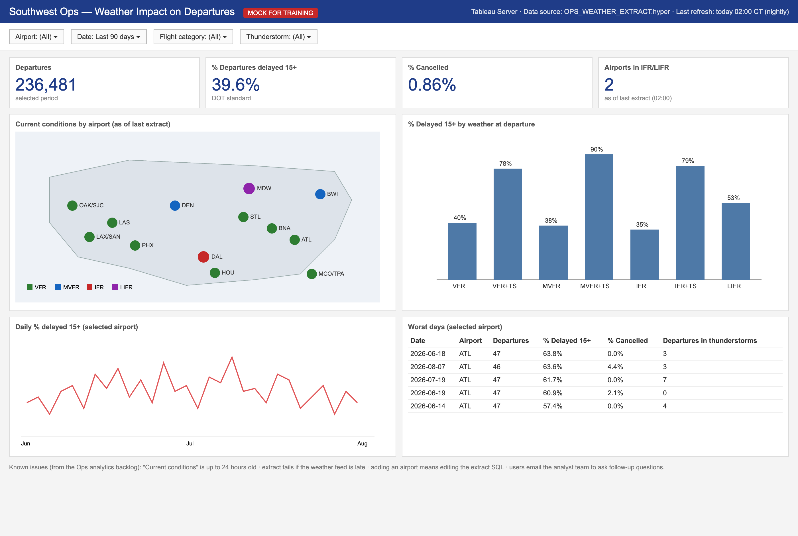
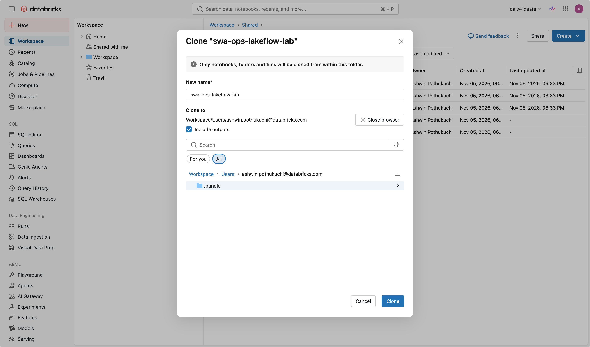

# Mission 0 — Get your bearings and set up

**Time:** 15 min · **You'll use:** Workspace browser, a notebook, Catalog Explorer

## The situation

Southwest's Ops analytics team runs a Tableau dashboard called *Weather Impact on Departures*. It refreshes overnight from an extract, so its "current conditions" can be 24 hours old, and every follow-up question becomes an email to an analyst. You'll rebuild it today on Databricks: live weather straight from the source, history from public flight data, an AI/BI dashboard, a Genie agent people can ask questions, and an app.

*(This is a mock built for the training. All data in the lab is public.)*

## Where things are

Everything is in the left sidebar. You'll use these, in this order:

| Sidebar item | What it's for | Missions |
|---|---|---|
| **Workspace** | Your files and folders. Your home folder is `Users` → your email. | 0 |
| **Catalog** | Browse catalogs, schemas, tables, and volumes. Preview data. | 0–3 |
| **Jobs & Pipelines** | Create and run pipelines; schedules. | 1–4 |
| **SQL Editor** | Run ad-hoc SQL. | 2–3 |
| **Dashboards** | AI/BI dashboards. | 5 |
| **Genie Agents** | Natural-language Q&A on your data. | 6 |
| **App switcher** (the 9-dot grid, top right) → **Databricks Apps** | Databricks Apps and Genie App Builder. Apps are no longer in the sidebar. | 7 |

**Genie Code** is the AI assistant icon in the upper-right corner of most pages. It's your main building tool from Mission 1 on.

If you can't find something, use the search bar at the top of the page.

## Your goal

Get your own copy of the lab, load the data into your own schema, and see your progress checker run.

## Steps

1. **Copy the lab.** Sidebar → **Workspace** → `Shared` → `swa-ops-lakeflow-lab`. Open the ⋮ menu at the top right of the folder page → **Clone**. Two things to change in the dialog:
   - **New name:** `swa-ops-lakeflow-lab` (remove the `(Clone)` prefix)
   - **Clone to:** click **Browse** → `Users` → your email. The default is `Shared`, which would put your copy where everyone works.

   

   Work only in your copy from here on.
2. **Run setup.** In your copy, open `src/setup/00_setup`. Compute should already say **Serverless** (top right). Click **Run all**. It takes 1–5 minutes and:
   - creates your schema `temp_ai_training_2026.<you>` and a volume named `raw`
   - loads three folders of raw files into the volume (flights, weather history, airports)
   - creates `my_pipeline/` in your lab folder, with the live-weather data source already inside
   - installs the **swa-lab-coach** skill in your Genie Code (only you see it)
3. **Look at your data.** Sidebar → **Catalog** → `temp_ai_training_2026` → your schema → **Volumes** → `raw`. Open a file in `bts/` and one in `weather_history/`. Spend two minutes on them: what would you need to fix before you could chart these?
4. **Run the checker.** Open `labs/check_progress` and **Run all**.

## Done when

- `check_progress` shows **Mission 0 — Setup: DONE**.
- You can name one data quality problem in the raw files.

## Stuck?

Hint 1

The setup notebook prints errors at the bottom of the cell that failed. Permission errors (`PERMISSION_DENIED`, `CREATE SCHEMA`) go to your instructor. Everything else: rerun the notebook. It skips what's already done.

Hint 2

Open Genie Code (upper right) in the notebook and ask: *"@swa-lab-coach setup failed with this error: ..."* and paste the error.

## How this lab works

- Each mission gives you a **goal** and a **"done when"** test. It doesn't give you code. Use Genie Code: write your own prompts from the goal. Your prompts will be different from your neighbor's, and that's fine.
- Run **`labs/check_progress`** whenever you like. It checks the *pattern* (is there a streaming table, is it fresh, is there a dashboard on it), not exact names or numbers.
- When you're stuck, use the **Stuck?** hints in order. Then ask `@swa-lab-coach` in Genie Code. Then ask a neighbor or the instructor.
- A finished reference version is in `src/pipeline/` and `app/`. Look at it after you've tried, not before.

Next: [Mission 1 — Stream live weather](01-live-stream.md)
