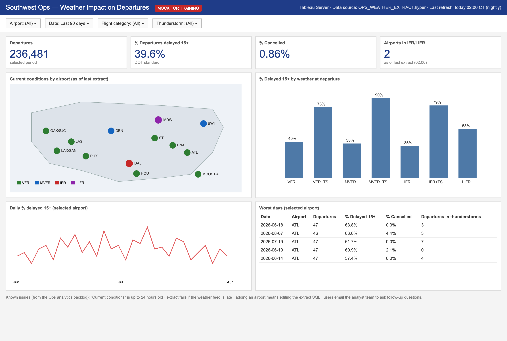
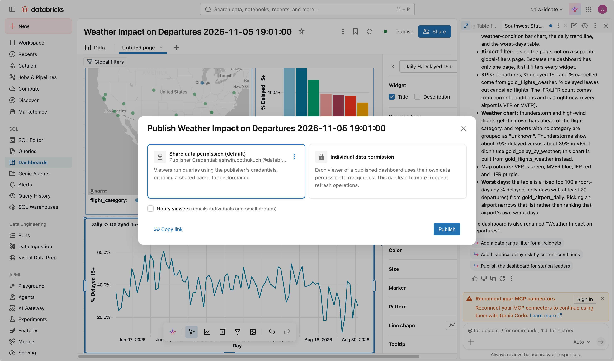
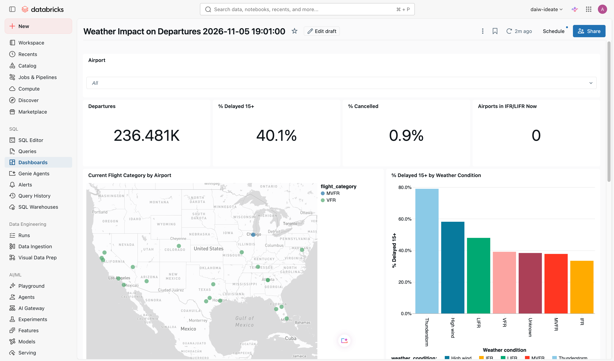

# Mission 5 — Rebuild the dashboard with AI

**Time:** 30 min · **You'll use:** AI/BI dashboards, Genie Code · **Docs:** [Genie Code for dashboard authoring](https://docs.databricks.com/aws/en/dashboards/manage/dashboard-agent)

## The situation

Here's the dashboard Ops uses today:

Its problems are in the footer: data up to 24 hours old, an extract that breaks, a change request for every new airport, and an email to an analyst for every follow-up question. Your tables from Missions 1–4 are already fresher than this.

## Your goal

Rebuild this dashboard as an **AI/BI dashboard**, directly on your pipeline tables. No extract and no copy of the data. Build it mostly by describing it to **Genie Code**. It should:
- cover the same panels (KPIs, current conditions map, delay rate by weather, daily trend, worst days, filters)
- show **live** conditions from your streaming data
- be **published with Genie enabled**, so viewers can ask follow-up questions next to the charts
- **refresh on a schedule**

It doesn't need to look identical. Make it better if you can.

## Steps (the what, not the how)

1. Sidebar → **Dashboards** → **Create dashboard**. Genie Code is in the middle of the empty canvas.
2. In the Genie Code panel, click **New chat** first if it still shows an earlier conversation (from your pipeline). Then describe what you want. Reference your tables with `@` (type `@` and pick from the list), or name them in full (`catalog.schema.table`).
3. Review what it builds. Fix what's wrong by asking, not by clicking. Then polish by hand if you like.
4. **Publish** it. The publish dialog asks a question that matters for real dashboards: **whose permissions do viewers' queries run with?**
   - **Share data permission** (default): everyone sees the data as *you* see it, and results are cached and shared. Fast, but viewers see data they might not be granted directly.
   - **Individual data permission**: each viewer's own Unity Catalog access applies. Right for governed or sensitive data; more queries run.

   Pick one and be ready to say why. For this lab's public data, either is fine. For SWA data with row filters or masks, you'd normally choose individual.

   

   Genie is turned on for published dashboards by default. There's no toggle in this dialog. After publishing, a **sharing** dialog opens; close it and click **View published**.
5. On the published view, click **Schedule** (top right) and add a refresh schedule.

### Prompt ingredients

- Start with the **audience and purpose** ("for station operations leaders to see where weather is hurting on-time departures right now and historically").
- List the **panels** you want, or describe the screenshot.
- Say which **table** feeds which panel, at least for the live map.
- Iterate in small steps: "make the map color by flight category", "add an airport filter that applies to every page", "beautify this dashboard".

## Done when

- The dashboard has at least 4 widgets, including one on live conditions.
- It's published, and on the published view you can ask Genie a question (see Mission 6 for where the button is).

What a finished dashboard looks like (yours will differ):

- It has a refresh schedule.
- After your pipeline's next scheduled run and the dashboard's next refresh, the live panel shows newer data. Check the "last observation" time.
- `check_progress`: **Mission 5** checks pass.

## Why the schedule matters

AI/BI dashboards cache query results. When your pipeline writes new data, a published dashboard doesn't show it until the dashboard refreshes. Pipeline schedule and dashboard schedule together decide how fresh the screen is. What's the oldest the data on screen could be, given both schedules?

## Stuck?

Hint 1

If Genie Code picks the wrong table, start a new message with `@your_table_name` and be explicit about which panel uses it.

Hint 2

Prompts that work well: *"Create a dashboard from @gold_live_delay_risk and @gold_airport_daily ..."*, *"Add a point map of airports using latitude and longitude, colored by flight_category"*, *"Add a global filter for airport"*, *"Beautify this dashboard."*

## Real migrations

This mission rebuilds from a picture. For real Tableau or Power BI workbooks, AI/BI can **import** `.twb`/`.twbx` (and Power BI) files and convert them: Dashboards → the arrow next to **Create dashboard** → **Import**, or `/importBI` in Genie Code ([docs](https://docs.databricks.com/aws/en/dashboards/manage/import-bi)). If your team has a non-production workbook, try it after the session.

## Reflect

- What did you ask Genie Code for that it got right the first time? What took three tries? What made the difference?

Next: [Mission 6 — Decide where Genie lives](06-genie.md)
