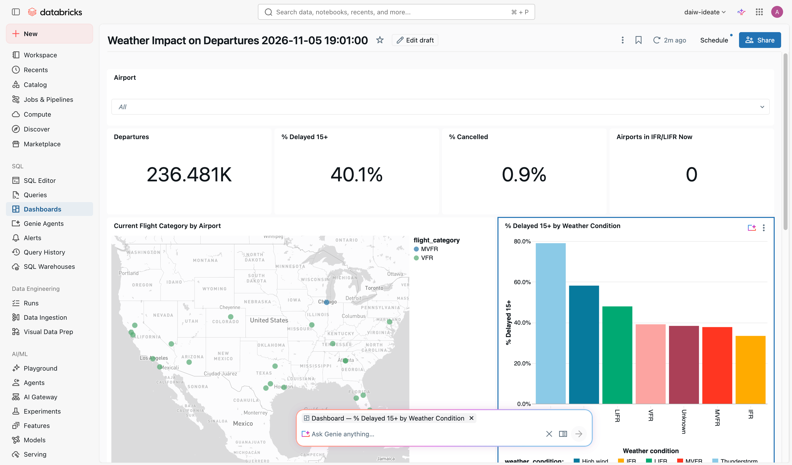

# Mission 6 — Test your dashboard's Genie, then decide if you need more

**Time:** 20 min · **You'll use:** AI/BI dashboards, Genie · **Docs:** [Genie on dashboards](https://docs.databricks.com/aws/en/dashboards/genie-spaces)

## The situation

The old dashboard's last problem: every follow-up question became an email. Genie lets people ask in plain English and get an answer with the SQL behind it. But there's more than one place to put it, and teams at Southwest will face this choice on every dashboard they migrate.

## The options

| | **Genie on the dashboard** | **Standalone Genie agent** | **Genie inside an app** |
|---|---|---|---|
| How | Publish with **Enable Genie** on. A companion agent is created from the dashboard's datasets, or you link an existing agent. | Sidebar → **Genie Agents** → **New**. Pick tables, write instructions, add example questions. | An app calls a Genie agent (Mission 7). |
| Users ask about | What's on this dashboard | A whole subject area, across many tables | Whatever the app is for, inside its workflow |
| You can tune | Little. The companion agent is rebuilt from the dashboard when you republish; its instructions can't be edited. | Instructions, example SQL, trusted answers, table and column descriptions | Same as the agent it uses |
| Good when | Viewers want "why is this number high?" next to the chart | Analysts and leaders explore beyond one dashboard | The question is one step in a task |

## Your goal

Your dashboard already has Genie (Mission 5). Now find its limits.

1. On the **published** dashboard, ask the dashboard's Genie the questions below. Note which ones it answers well and which it can't.
   - **Where's Genie?** Hover over any chart. A small **Ask Genie** sparkle icon appears next to its ⋮ menu. Click it and an **Ask Genie anything…** box opens, scoped to that chart; the Genie panel opens on the right when you ask. You can remove the chart from the context (✕) to ask about the whole dashboard.

   
2. Decide: is dashboard Genie enough for Ops, or do they also need a **standalone Genie agent** (or Genie inside an app)? Write two or three sentences explaining why, in a text box on the dashboard or a notebook cell.
3. **Optional:** if you decided a standalone agent is worth it, build it (Sidebar → **Genie Agents** → **New**) and ask it the same questions. Compare.

## Questions to try

1. Which airports are reporting IFR or LIFR right now, and how did Southwest do historically in those conditions there?
2. How much higher is the delay rate in thunderstorms than in clear weather, by airport?
3. What were the five worst days at Chicago Midway, and what was the weather?
4. Which hour of the day is worst for delays at Denver?
5. Is IFR without thunderstorms really better than VFR? Why might that be?

For each, click **Show generated code** at least once. Is the SQL doing what you meant?

## If you build a standalone agent (optional)

Add instructions with the definitions people will assume: what "delayed" means (15+ minutes), what "bad weather" means (IFR or LIFR), that history is June–August 2026, and that live conditions are current but not joined to current flights. When an answer is right, save it as a trusted answer. When it's wrong, fix the SQL and save the correct version.

## Done when

- Your dashboard's Genie answers questions 1–3 on your data.
- Your "is dashboard Genie enough?" note exists.
- `check_progress`: **Mission 6** passes.

## Reflect

- Your neighbor picked differently. Compare reasons. Which would you choose for station leaders on their phones? For the Ops analytics team?

Next: [Mission 7 (optional) — Build an app with Genie App Builder](07-app.md), or skip to the [Wrap-up](08-wrap-up.md)
