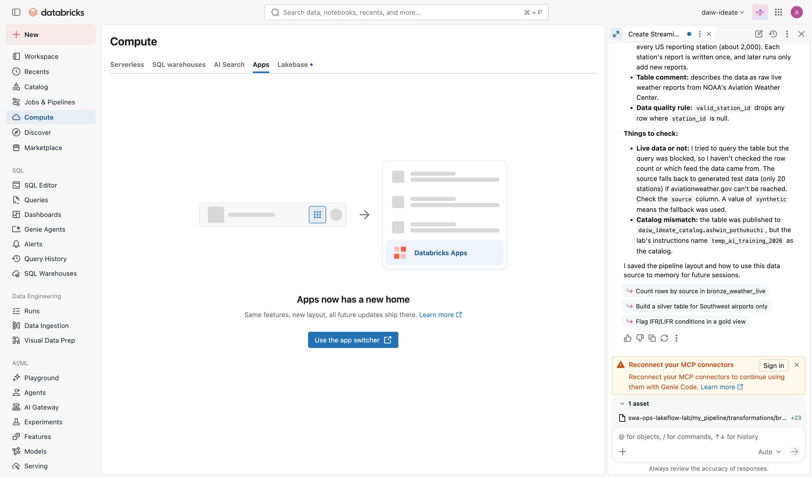

# Mission 7 (optional) — Build an app with Genie App Builder

**Optional.** Do this if you have time and your workspace has Genie App Builder. The core lab ends at Mission 6.

**Time:** 30 min · **You'll use:** Apps, Genie App Builder · **Docs:** [Genie App Builder](https://docs.databricks.com/aws/en/dev-tools/databricks-apps/genie-app-builder)

## The situation

A dashboard shows information. Ops also wants to *do* something with it. At the start of each shift, a duty manager checks which stations have bad weather coming and decides where to send attention. Today that's a spreadsheet and a group chat. Build them a small tool.

## Your goal

Use **Genie App Builder** to build and deploy a **Station Weather Watch** app on your tables:
- shows the airports where conditions are worse than clear weather right now, ranked by how much delays usually rise in those conditions
- lets the duty manager pick an airport and see its current report and historical delay rate
- lets them mark an airport as **"watching"** with a short note, and shows the watch list

You decide the layout and anything else it does.

## Before you start

Apps aren't in the workspace sidebar anymore. Open the **app switcher** (the 9-dot grid at the top right) → **Databricks Apps**. (If you go to Compute → Apps you'll see "Apps now has a new home" with a button to the same place.)

Genie App Builder builds apps inside an **App Space** that your instructor set up for the training. In Databricks Apps you should see a **Build** option and **App Spaces**. If you only see **Apps** and **Create app**, tell your instructor: the workspace needs the *Governed agentic app-building* preview, and you need access to the lab App Space.

## Steps (the what, not the how)

1. **Databricks Apps** → **Build** → pick the lab App Space → name the app `<you>-weather-watch`.
2. Describe the app. Look at the preview. Ask for changes until it does what the duty manager needs.
3. **Deploy** it. Open it, try it, and **share** it with a neighbor (**Can use**).
4. Ask your neighbor to use it without explanation for one minute. What confused them? Fix one thing.

### Prompt ingredients

- **Who** uses it and **when** ("duty manager at the start of a shift, on a laptop").
- **What data**: name your catalog, schema, and tables (`temp_ai_training_2026.<you>.<table>`).
- **What they do**: the three tasks above. Be concrete about what's on screen.
- **How it should feel**: "simple, one screen, the worst airports at the top".
- Build in steps: the ranked list first, then the detail, then the watch list.

## Done when

- The app is running and shows your live and historical data.
- Your neighbor can use it.
- `check_progress`: **Mission 7 (optional)** passes.

## Things to notice

- **Who is the app?** Apps in an App Space run with the signed-in user's permissions (or resources an admin shared to the space). If your neighbor sees "no data", what grant would they need on your schema?
- **Where does the watch list live?** Micro apps lose in-memory state when they scale down. Ask Genie App Builder where it stored the watch list, and what happens tomorrow morning. A real version would write to a table or Lakebase.
- **Genie in the app**: if you chose a standalone Genie agent in Mission 6, ask App Builder to add an "Ask a question" box that uses it.

## Stuck?

Hint 1

If the app shows no data, ask App Builder: "Show me the query you're running and the error."

Hint 2

Ask your instructor which SQL warehouse is shared to the App Space, and name it in your prompt.

## If Genie App Builder isn't available

Use the pro-code path: **Databricks Apps** → **Create app** → **Custom**, add a SQL warehouse resource named `sql-warehouse` and the `sql` user authorization scope, and deploy the reference Streamlit app in `app/` from your lab folder. Then use Genie Code in the workspace editor to add the watch list. See `app/README.md`.

Next: [Wrap-up](08-wrap-up.md)
